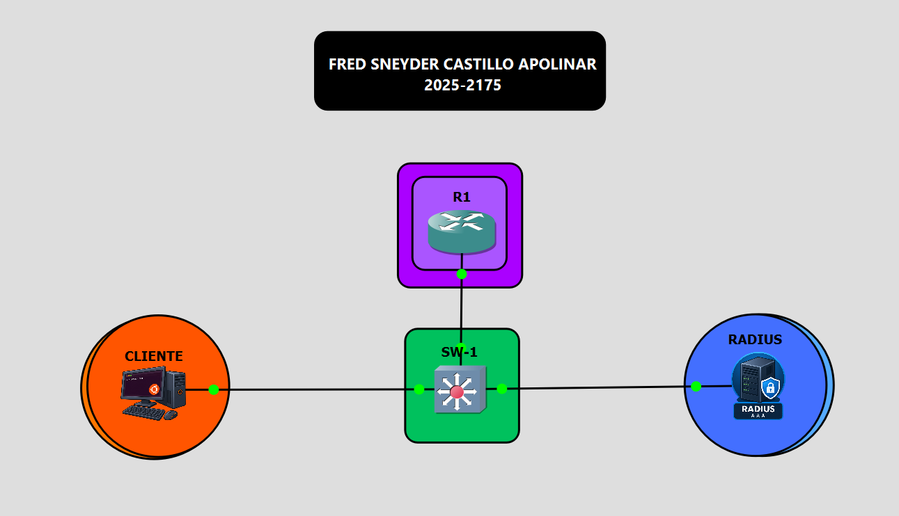
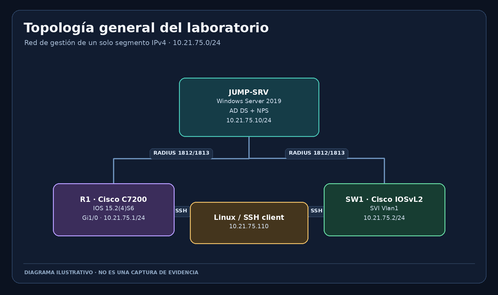
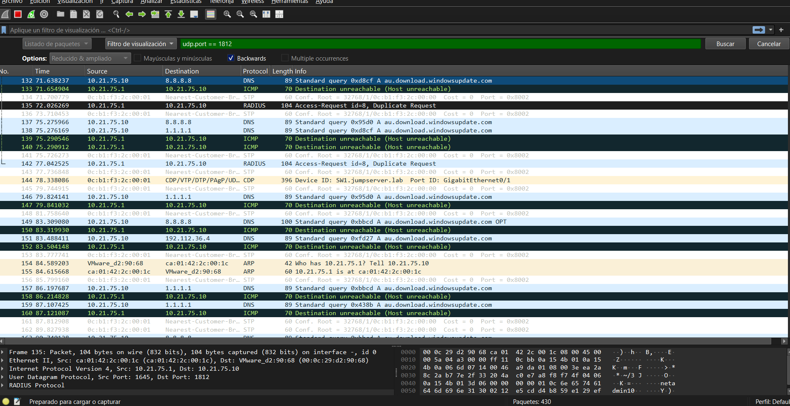
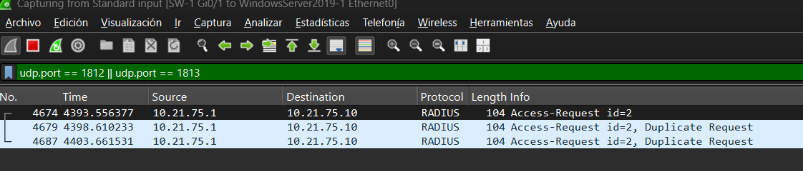
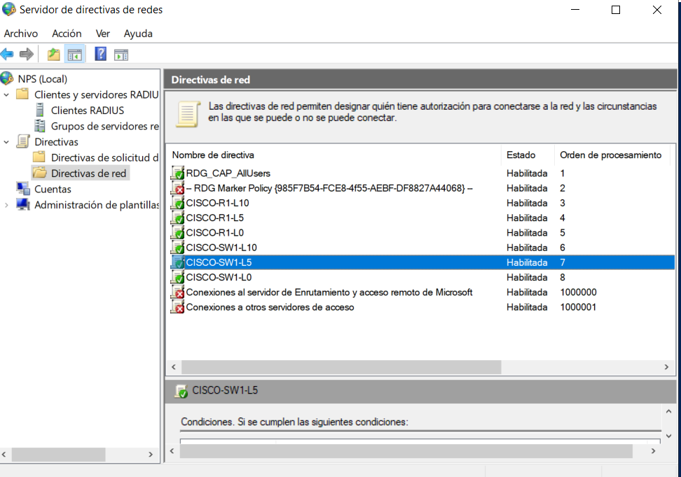
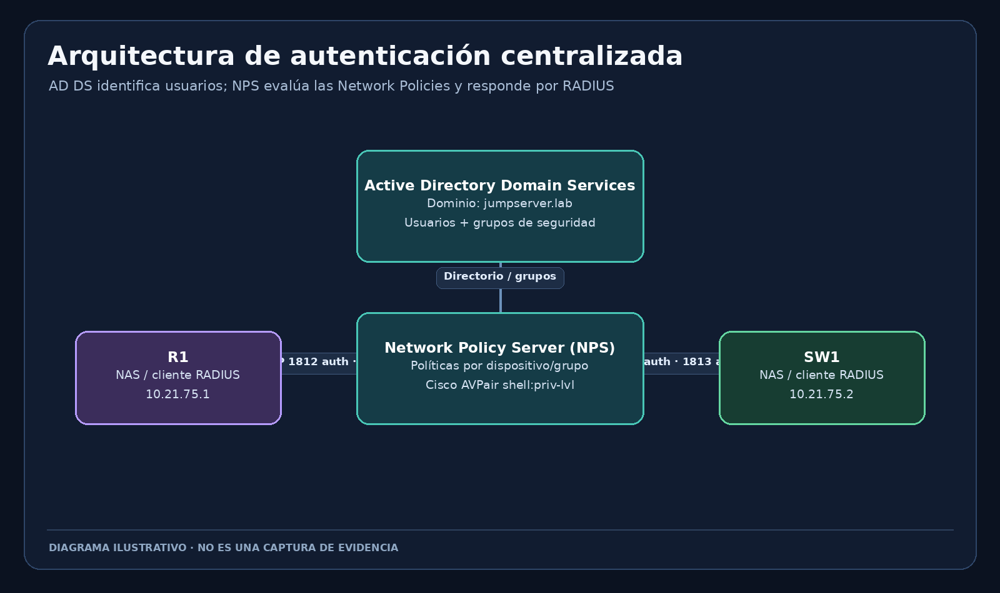
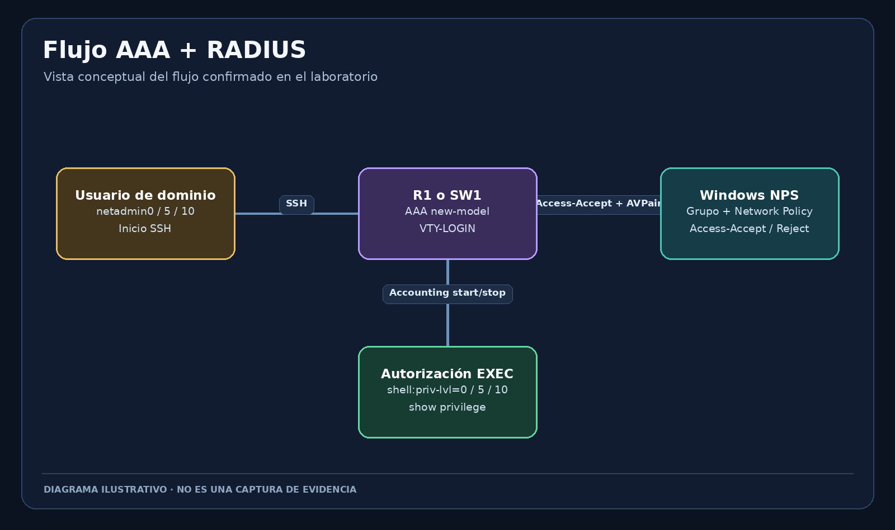

<div align="center">

# Cisco AAA & RADIUS Centralized Access Security Lab

**Control de acceso administrativo centralizado para Cisco IOS/IOSvL2 con Active Directory y Windows NPS**

<p align="center">
  <a href="https://github.com/fredcastillo/cisco-aaa-radius-lab"></a>
  <a href="https://github.com/fredcastillo/cisco-aaa-radius-lab"></a>
  <a href="https://github.com/fredcastillo/cisco-aaa-radius-lab"></a>
  <a href="https://github.com/fredcastillo/cisco-aaa-radius-lab"></a>
  <a href="https://github.com/fredcastillo/cisco-aaa-radius-lab"></a>
  <a href="https://github.com/fredcastillo/cisco-aaa-radius-lab"></a>
  <a href="https://github.com/fredcastillo/cisco-aaa-radius-lab"></a>
</p>

</div>

## Topología

<p align="center">
  
</p>

<details>
<summary>Vista conceptual complementaria (no es una captura de GNS3)</summary>

<p align="center">
  
</p>
</details>

## Resumen ejecutivo

Este laboratorio virtual implementa autenticación administrativa centralizada para un router Cisco C7200 (R1) y un switch Cisco IOSvL2 (SW1). Windows Server 2019, en el dominio `jumpserver.lab`, presta servicios de Active Directory Domain Services (AD DS), DNS y Network Policy Server (NPS). NPS actúa como servidor RADIUS y utiliza grupos de Active Directory para distinguir tres niveles EXEC: **0, 5 y 10**.

La administración remota se realiza mediante SSH. Las políticas Cisco devuelven el atributo `shell:priv-lvl` para asignar el nivel de la sesión. Las listas AAA de VTY incluyen fallback local; la consola y AUX usan listas locales dedicadas, según los fragmentos de configuración final disponibles.

## Inventario técnico

| Nodo | Plataforma / función | Dirección | Estado y notas |
|---|---|---:|---|
| **R1** | Cisco C7200 · IOS 15.2(4)S6 · ADVENTERPRISEK9-M | `10.21.75.1/24` en `GigabitEthernet1/0` | SSH y cliente RADIUS configurados; vecino CDP de SW1 confirmado. |
| **SW1** | Cisco IOSvL2 15.2 | `10.21.75.2/24` en `Vlan1` | SVI `up/up`; vecino CDP R1 en `Gi0/0`; host NPS es cliente RADIUS. |
| **JUMP-SRV** | Windows Server 2019 · AD DS · DNS · NPS | `10.21.75.10/24` | Dominio `jumpserver.lab`; IAS/NPS escucha en UDP/1812 y UDP/1813 según verificaciones documentadas. |
| **Cliente SSH** | Linux / contenedor del laboratorio | `10.21.75.110` | Cliente OpenSSH con script para conectarse a R1 o SW1. |
| **Dominio** | Active Directory | `jumpserver.lab` | Grupos `GG_NET_LEVEL0`, `GG_NET_LEVEL5`, `GG_NET_LEVEL10`. |

Todos los nodos usan la subred `10.21.75.0/24`. SW1 usa `10.21.75.1` como gateway de administración. No se ha documentado una ruta por defecto en R1, y no es necesaria para el tráfico entre direcciones de la misma subred.

## Qué hace el laboratorio

- Centraliza identidades de acceso a infraestructura Cisco en Active Directory.
- Autentica por SSH contra NPS/RADIUS.
- Asigna niveles EXEC 0, 5 y 10 mediante políticas NPS y el atributo Cisco AVPair `shell:priv-lvl`.
- Mantiene autenticación local como vía de recuperación, sin reemplazar el método local de consola.
- Registra eventos de autorización de NPS (6272 concedido y 6273 rechazado) y accounting EXEC por RADIUS.
- Demuestra el diagnóstico de políticas NPS mediante un caso real: `CISCO-SW1-L5` no se seleccionaba; al quitar su condición de dirección/NAS y conservar el grupo `GG_NET_LEVEL5`, la autenticación de `netadmin5` en SW1 pasó a funcionar.

## Evidencia real incorporada

Las imágenes siguientes sí proceden de capturas compartidas del entorno. Las dos capturas de Wireshark son **evidencia histórica de diagnóstico**: enseñan solicitudes Access-Request retransmitidas y un paquete ICMP *Host unreachable*. No deben interpretarse como el estado final después de las correcciones.

<table>
<tr>
<td width="50%"><a href="images/06-wireshark-radius-diagnostico.png"></a><br><strong>06 · Wireshark: diagnóstico RADIUS</strong></td>
<td width="50%"><a href="images/07-wireshark-radius-retransmisiones.png"></a><br><strong>07 · Wireshark: solicitudes repetidas</strong></td>
</tr>
<tr>
<td colspan="2"><a href="images/08-nps-politicas-red.png"></a><br><strong>08 · NPS: lista de políticas de red</strong> — demuestra la existencia y el orden visible de las políticas, no la ejecución de una autenticación por sí sola.</td>
</tr>
</table>

## Arquitectura de la solución

<p align="center"></p>

<p align="center"></p>

`R1` y `SW1` son clientes RADIUS; `JUMP-SRV` toma la decisión usando las políticas NPS, que deben coincidir con el grupo de AD y devolver el atributo Cisco adecuado. El cliente RADIUS en NPS se define por IP: R1 es `10.21.75.1` y SW1 es `10.21.75.2`. Cada dispositivo utiliza su propio secreto compartido, deliberadamente excluido del repositorio.

## Políticas de autorización esperadas

| Política NPS | Cliente RADIUS | Grupo de AD | Atributo Cisco |
|---|---:|---|---|
| `CISCO-R1-L0` | `10.21.75.1` | `GG_NET_LEVEL0` | `shell:priv-lvl=0` |
| `CISCO-R1-L5` | `10.21.75.1` | `GG_NET_LEVEL5` | `shell:priv-lvl=5` |
| `CISCO-R1-L10` | `10.21.75.1` | `GG_NET_LEVEL10` | `shell:priv-lvl=10` |
| `CISCO-SW1-L0` | `10.21.75.2` | `GG_NET_LEVEL0` | `shell:priv-lvl=0` |
| `CISCO-SW1-L5` | `10.21.75.2` | `GG_NET_LEVEL5` | `shell:priv-lvl=5` |
| `CISCO-SW1-L10` | `10.21.75.2` | `GG_NET_LEVEL10` | `shell:priv-lvl=10` |

El detalle funcional de `CISCO-SW1-L5` es relevante: se retiró la condición `NAS IPv4 Address = 10.21.75.2` que impedía que la política fuera seleccionada, conservando `GG_NET_LEVEL5`. La autenticación de `netadmin5` en SW1 quedó comprobada mediante `test aaa group NPS-GROUP ... legacy`, el acceso SSH y `show privilege` (nivel 5). Véase [incidencias documentadas](docs/09-incidencias-documentadas.md).

## Organización del repositorio

| Carpeta / archivo | Contenido |
|---|---|
| [`docs/`](docs/) | Diez documentos técnicos; cada uno contiene imágenes Markdown visibles y contextualizadas. |
| [`images/`](images/) | Diagramas, evidencias reales compartidas y marcador para la captura real de GNS3. |
| [`diagrams/`](diagrams/) | Fuentes Mermaid editables de los cuatro diagramas conceptuales. |
| [`scripts/`](scripts/) | Script SSH reutilizable para conectarse a los dos equipos. |
| [`commands/`](commands/) | Comandos Cisco y PowerShell con IPs, grupos, puertos e IDs ya conocidos. |
| [`running-configs/`](running-configs/) | Extractos de configuración conocidos, sin secretos; no se presentan como dumps completos. |
| [`tests/`](tests/) | Matriz para registrar la validación de los seis cruces dispositivo/usuario. |

## Documentación técnica

| N.º | Documento | Qué encontrarás |
|---:|---|---|
| 01 | [Propósito y alcance](docs/01-proposito-y-alcance.md) | Objetivos, alcance, exclusiones y criterios de éxito. |
| 02 | [Arquitectura e infraestructura](docs/02-arquitectura-e-infraestructura.md) | Nodos, enlaces, flujo de AAA y dependencias. |
| 03 | [Plan de direccionamiento](docs/03-plan-de-direccionamiento.md) | IP, interfaz, máscara, gateway y puertos. |
| 04 | [Configuración paso a paso](docs/04-configuracion-paso-a-paso.md) | Secuencia reproducible, AD, NPS, IOS y SSH. |
| 05 | [Pruebas y validación](docs/05-pruebas-y-validacion.md) | Evidencia confirmada y matriz de prueba completa. |
| 06 | [Comandos utilizados](docs/06-comandos-utilizados.md) | Comandos exactos de consulta, prueba y diagnóstico. |
| 07 | [Servicios y protocolos](docs/07-servicios-y-protocolos.md) | SSH, RADIUS, AAA, AD DS, NPS, UDP y auditoría. |
| 08 | [Evidencias y fotografías](docs/08-evidencias-y-fotografias.md) | Capturas reales, diagramas y guía de captura. |
| 09 | [Incidencias documentadas](docs/09-incidencias-documentadas.md) | Fallo de selección NPS y corrección validada. |
| 10 | [Reproducibilidad y mantenimiento](docs/10-reproducibilidad-y-mantenimiento.md) | Requisitos, respaldo, seguridad y mantenimiento. |

## Preparar el entorno o reproducir las pruebas

1. Abre el proyecto de GNS3 y confirma que `R1`, `SW1`, `JUMP-SRV` y el cliente Linux usan las direcciones indicadas.
2. En Windows Server, verifica que IAS/NPS está en ejecución y escucha en UDP/1812 y UDP/1813.
3. En NPS, revisa los dos clientes RADIUS, las seis políticas y los grupos AD; no cambies las políticas de RD Gateway.
4. Desde el cliente Linux, ejecuta el script pasando la IP y el usuario. Dentro de la sesión Cisco ejecuta `show privilege` y luego `exit`.
5. Correlaciona el intento con eventos 6272/6273 en `JUMP-SRV` y con `show aaa servers` en el dispositivo.
6. Registra cada resultado obtenido en `tests/test-matrix.csv`; no marques una prueba como aprobada sin observarla.

```bash
chmod +x scripts/conectar_r1_ssh.sh
./scripts/conectar_r1_ssh.sh 10.21.75.1 netadmin10
./scripts/conectar_r1_ssh.sh 10.21.75.2 netadmin5
```

El script conserva compatibilidad SSH heredada únicamente como opciones por conexión porque IOS en este laboratorio lo requiere. No se recomienda habilitar esos algoritmos globalmente ni replicar PAP en una red de producción.

## Límites y rigor técnico

- Los secretos RADIUS, contraseñas, `enable secret`, hashes y claves privadas nunca se incluyen.
- `R1-known-snippets.cfg` y `SW1-known-snippets.cfg` son fragmentos finales conocidos, no `show running-config` íntegros. Las líneas AAA, VTY, consola y AUX reflejan el estado final conocido; los parámetros sensibles del servidor RADIUS están redactados.
- Las capturas 06 y 07 son históricas y documentan un fallo anterior. La captura 08 es una vista de la lista de políticas, no prueba aislada de éxito.
- La matriz de pruebas conserva el estado probado que consta en el historial. Repite las seis combinaciones y captura `show privilege` para completar las evidencias del repositorio.
- El marcador `05-gns3-topologia-real.png` debe sustituirse por una captura de la topología auténtica antes de publicar.
- NPS usa PAP en la configuración documentada. Mantén este escenario en una red virtual aislada y considera métodos más robustos para un despliegue real.

## Licencia

Distribuido bajo [MIT](LICENSE).
