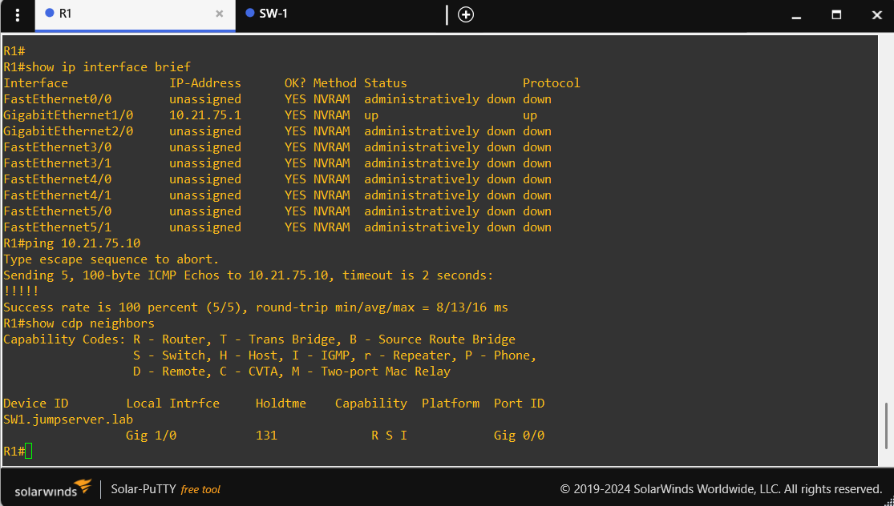
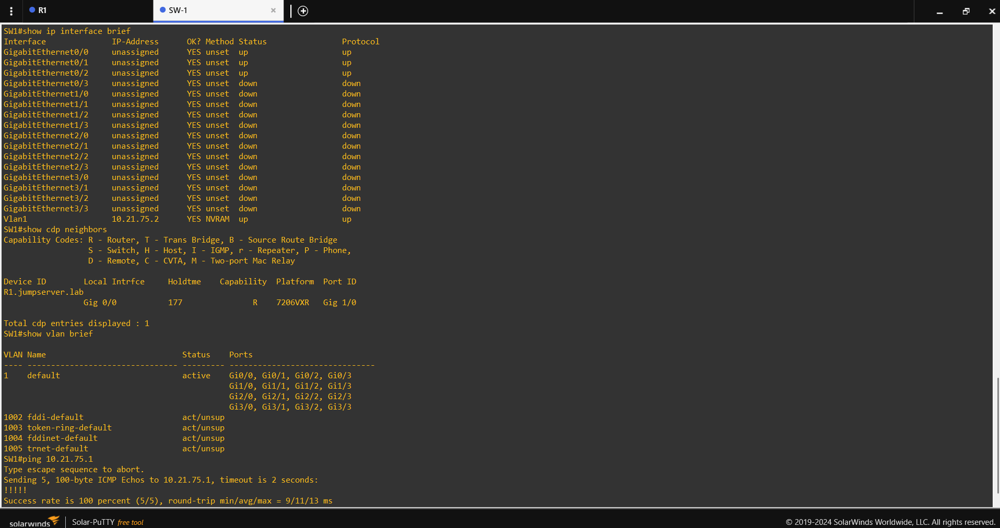

# 06. Comandos utilizados

Este documento centraliza los comandos conocidos y las consultas de diagnóstico relevantes. Los archivos reproducibles se guardan en `commands/`; aquí se explica cuándo utilizarlos y qué información producen.

## Identidad y conectividad Cisco

Ejecuta desde el prompt privilegiado `R1#` o `SW1#`:

```cisco
show version
show ip interface brief
show ip route
show cdp neighbors
show ip ssh
show running-config | section aaa
show running-config | section line
show running-config | include ip radius source-interface
```

En SW1, añade:

```cisco
show vlan brief
show interfaces trunk
```

`show interfaces trunk` puede no mostrar una interfaz si el lab funciona en una única VLAN de acceso; no implica por sí solo un fallo.






## Estado AAA/RADIUS y privilegio

```cisco
show aaa servers
show radius statistics
show privilege
```

`show privilege` se ejecuta una vez iniciada una sesión SSH con cada usuario de prueba. `show aaa servers` y `show radius statistics` muestran contadores acumulativos hasta que se limpian, así que anota el momento de la prueba.


*Figura 1. Evidencia de diagnóstico capturada con Wireshark. El filtro utilizado (`udp.port == 1812 || udp.port == 1813`) ayuda a encontrar paquetes RADIUS; la captura es histórica y no equivale a una verificación actual.*

## Prueba de autenticación RADIUS interactiva

La forma reportada como aceptada en SW1 fue:

```cisco
test aaa group NPS-GROUP netadmin5 <CONTRASEÑA_INTRODUCIDA_LOCALMENTE> legacy
```

`<CONTRASEÑA_INTRODUCIDA_LOCALMENTE>` es el único campo que no puede publicarse ni completarse en un documento: escribe el secreto real solo en la consola, sin compartirlo. En los equipos donde se utilice el nombre del grupo AAA tal como aparece en su configuración, conserva `NPS-GROUP`.

## Windows Server / NPS

En PowerShell elevado de `JUMP-SRV`:

```powershell
Get-Service IAS
Get-NetUDPEndpoint -LocalPort 1812,1813 -ErrorAction SilentlyContinue |
    Select-Object LocalAddress,LocalPort,OwningProcess
Get-NetIPAddress -AddressFamily IPv4 |
    Format-Table InterfaceAlias,IPAddress,PrefixLength,AddressState -AutoSize
```

Para revisar la auditoría NPS, sigue el script completo `commands/windows-nps-powershell.ps1` o abre Event Viewer → Windows Logs → Security y revisa eventos 6272, 6273 y 6274 inmediatamente después de una prueba.

## Cliente Linux: SSH a las dos IP

```bash
chmod +x scripts/conectar_r1_ssh.sh
./scripts/conectar_r1_ssh.sh 10.21.75.1 netadmin10
./scripts/conectar_r1_ssh.sh 10.21.75.2 netadmin5
```

El script acepta cualquier usuario de prueba y cualquiera de las dos IP conocidas. Ver [comandos/pruebas-ssh.md](../commands/pruebas-ssh.md).


*Figura 2. La consola NPS es el punto visual para relacionar las políticas con las pruebas SSH y sus comandos de verificación.*
