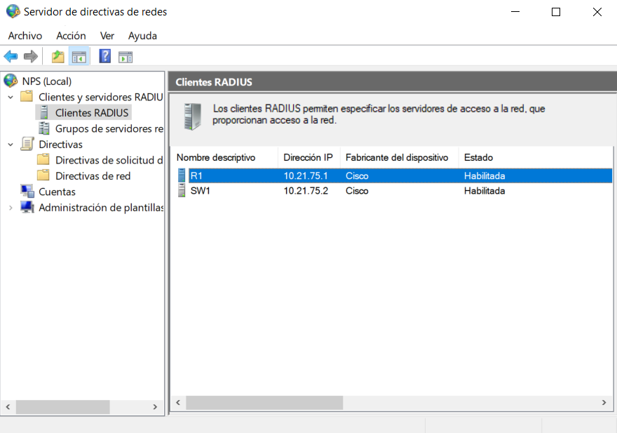
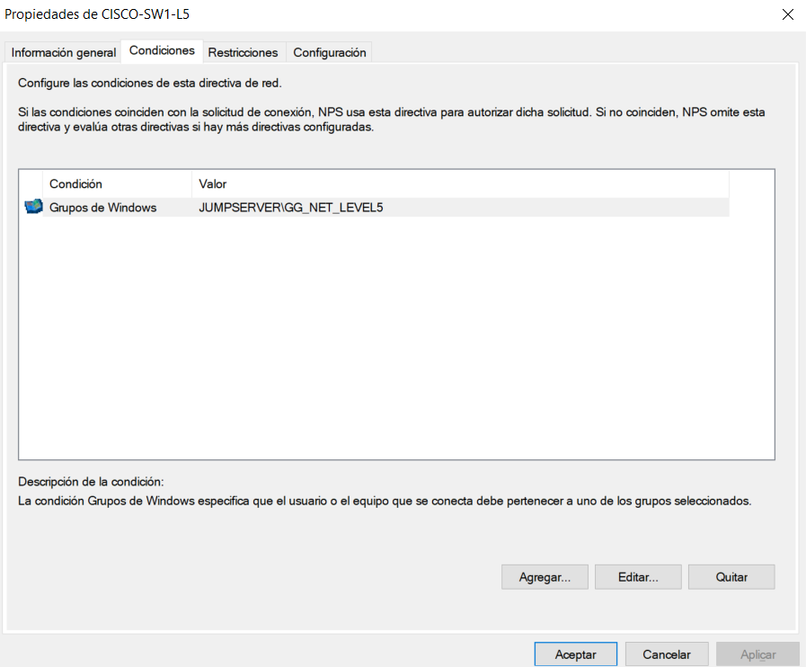
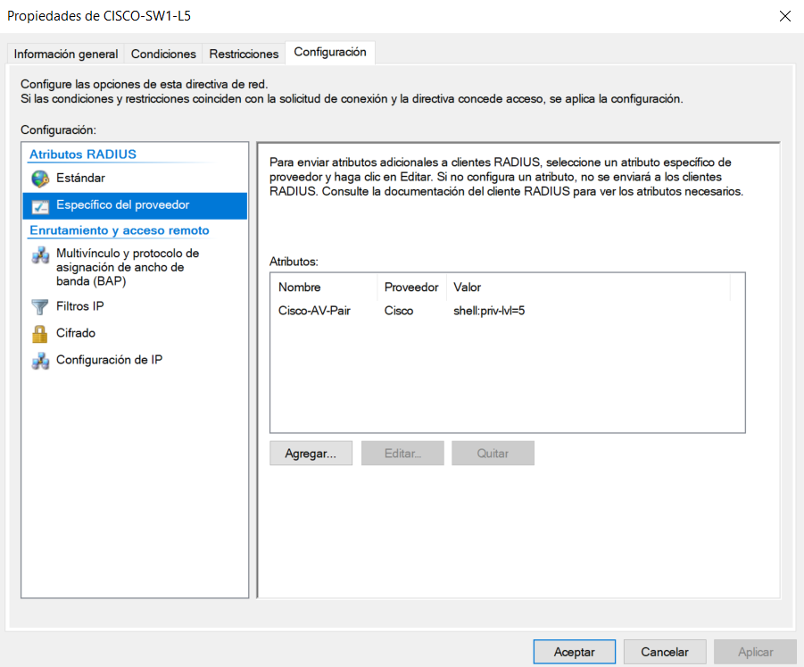
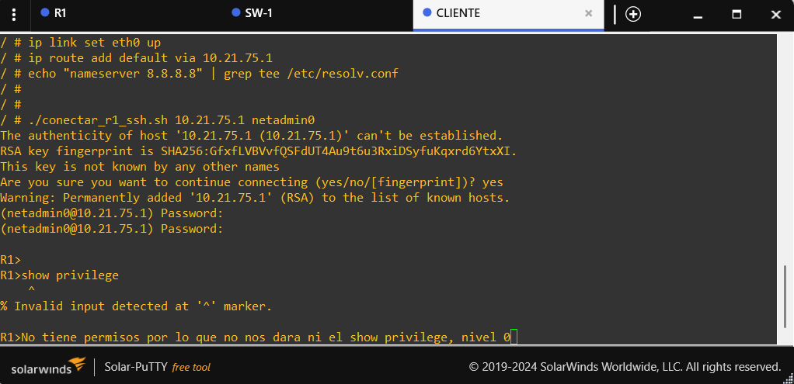
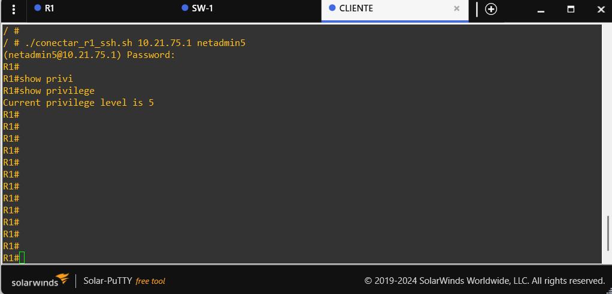
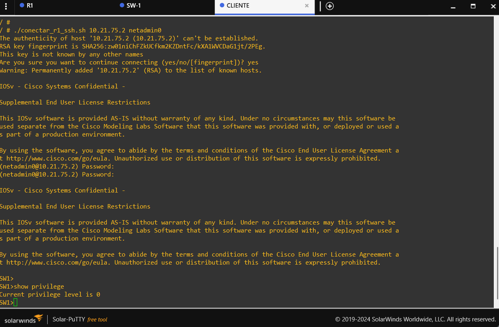
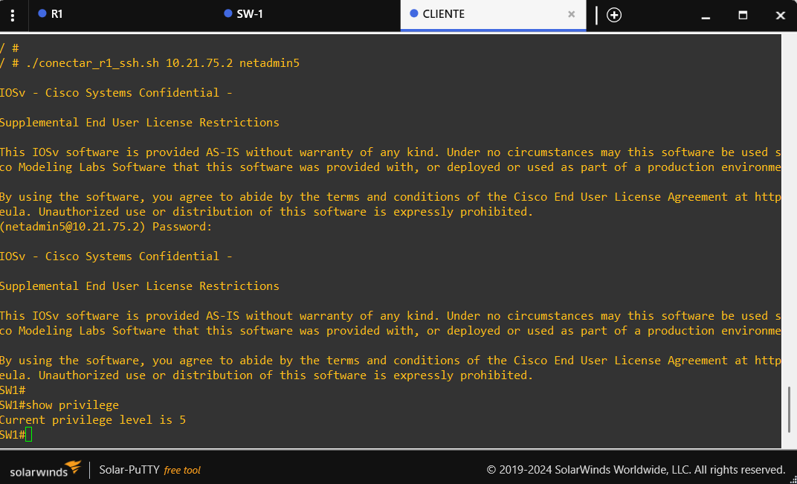
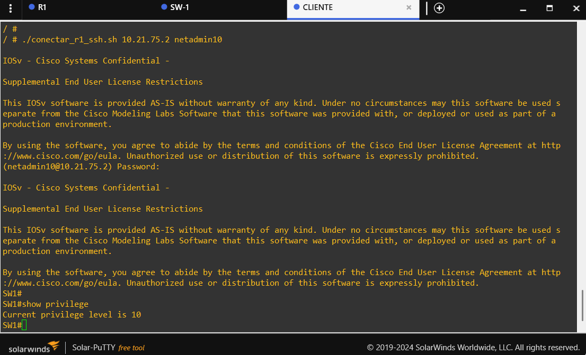
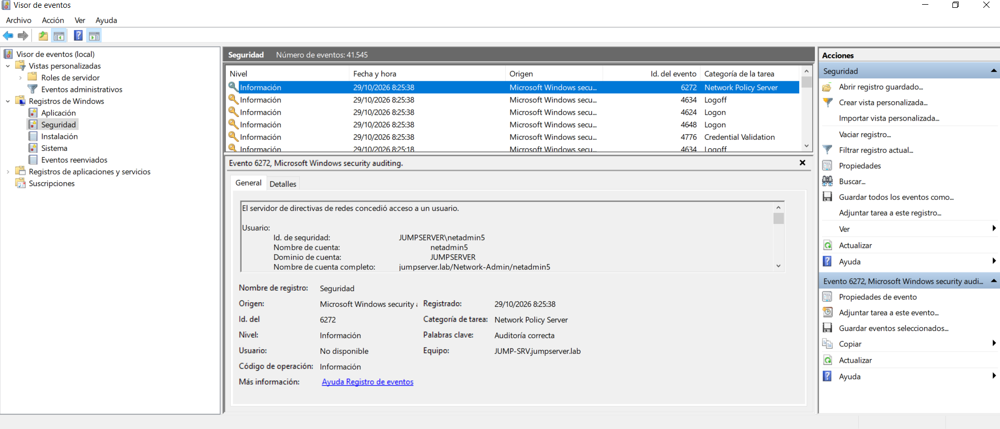

# 08. Evidencias y fotografías

Este documento distingue los diagramas conceptuales, las capturas auténticas existentes y las capturas nuevas que todavía debe obtenerse del entorno. Cada imagen Markdown se incrusta directamente en el documento: al reemplazar el archivo con el nombre indicado, la imagen renderizará automáticamente en GitHub.

## 1. Diagrama conceptual frente a topología real

*Figura 1. Diagrama explicativo; no es una captura real de GNS3.*

*Figura 2. El archivo actual es un marcador que indica explícitamente que la captura real está pendiente. Abre GNS3, encuadra R1, SW1, JUMP-SRV y el cliente Linux con todos los enlaces visibles, y guarda una captura en esta ruta con el mismo nombre para reemplazar el marcador.*

## 2. Captura real: solicitudes RADIUS e ICMP

*Figura 3. Captura real compartida. Muestra Access-Request desde `10.21.75.1` a `10.21.75.10` y mensajes ICMP `Destination unreachable (Host unreachable)`. Es evidencia histórica de una fase anterior.*

## 3. Captura real: solicitudes repetidas

*Figura 4. Captura real compartida con solicitudes repetidas hacia UDP/1812. No se presenta como el estado final del laboratorio.*

## 4. Captura real: políticas NPS

*Figura 5. Captura real compartida de las políticas de red. Se ven las seis políticas Cisco y otras políticas generales; la lista demuestra su presencia y orden visible, no la coincidencia de condiciones ni el resultado de una autenticación.*

## 5. Capturas que faltan

Las capturas concretas que completarán la evidencia son: conectividad actual R1 y SW1, la lista de clientes RADIUS de NPS, la condición y el atributo de `CISCO-SW1-L5`, las seis sesiones SSH con `show privilege`, y el evento 6272 de una prueba reciente. El procedimiento detallado para cada una está en [`PLAN-DE-CAPTURAS.md`](../images/PLAN-DE-CAPTURAS.md).

### Vista previa de las futuras evidencias

## 6. Reglas para mantener la evidencia fiable

- No inventes ni reconstruyas salidas de consola, eventos NPS o resultados de autenticación.
- Identifica como históricas las capturas de troubleshooting de una fase anterior.
- Usa PNG para conservar el texto legible; captura el prompt, el comando y la respuesta completa.
- No muestres contraseñas, hashes, secretos compartidos ni claves privadas.
- No alteres salidas de ping, contadores o eventos para que parezcan correctos.
- Guarda todos los PNG en `images/`; los diagramas fuente permanecen en `diagrams/`.
