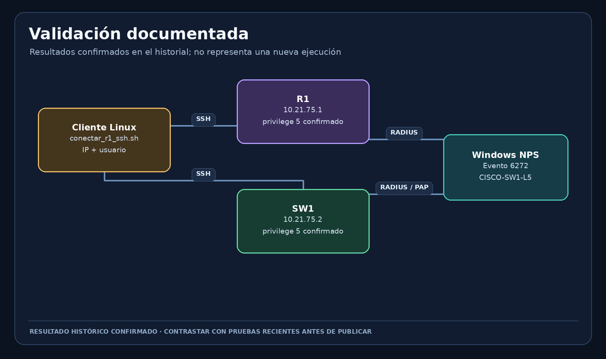

# Matriz de pruebas

`test-matrix.csv` recoge los seis pares dispositivo/usuario. `known_status` separa lo que quedó reportado en el historial de las capturas nuevas pendientes. Aunque una prueba se haya realizado anteriormente, repítela para generar evidencia fechada actual si el README público va a afirmar que toda la matriz está demostrada.

*Diagrama ilustrativo de validación, no captura de un test ejecutado ahora.*

En cada fila nueva, conserva la hora, `show privilege`, resultado SSH y evento NPS correlacionado. No almacenes contraseñas. Si falla, registra el fallo en vez de cambiar el estado a aprobado.
